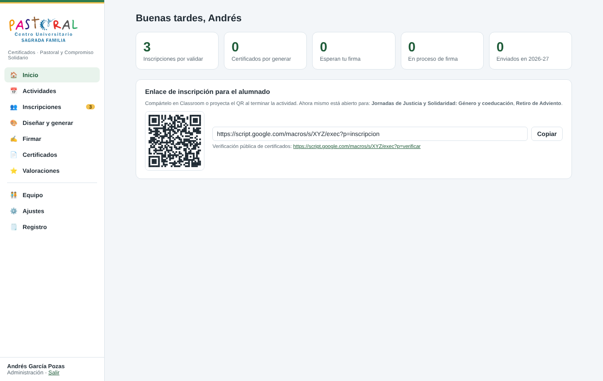
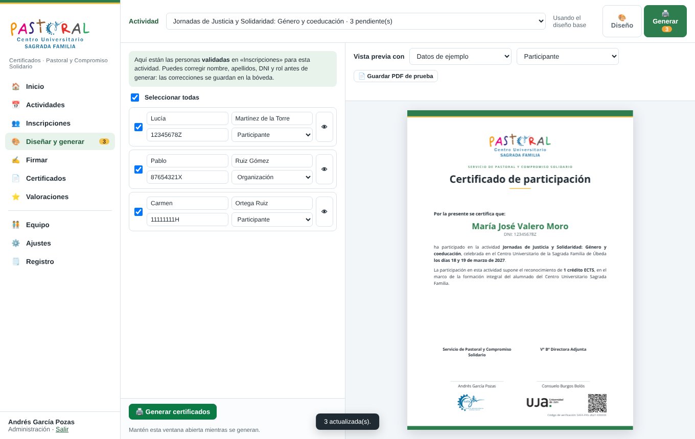
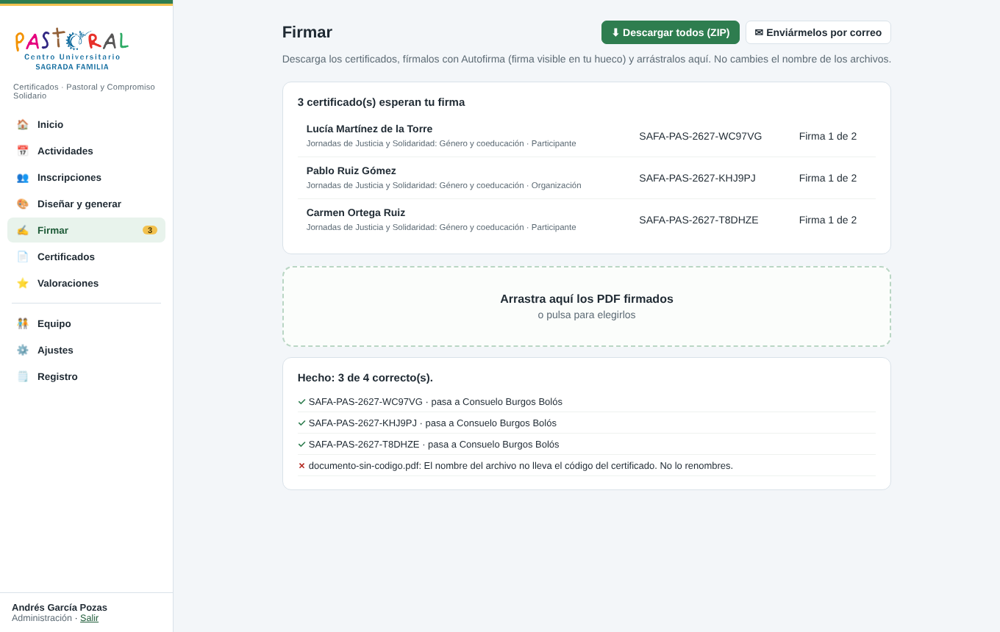
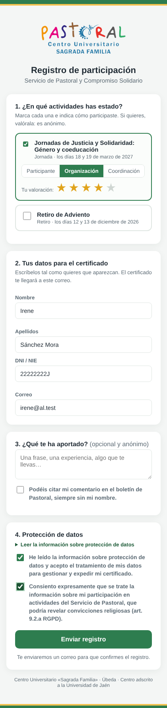

# Certificados de Pastoral · C.U. «Sagrada Familia» (Úbeda)

Aplicación web del **Servicio de Pastoral y Compromiso Solidario** para emitir los certificados de sus actividades.
Funciona sobre el Google Workspace del centro (Apps Script, Drive y Gmail): no tiene coste y los datos no salen de vuestro Google.

```
Alumnado ─ página de inscripción ─ confirma por correo
Equipo   ─ panel: valida → diseña y genera los PDF → firma 1 → firma 2 (Autofirma, subiendo los PDF)
Sistema  ─ envía el certificado al alumno/a → cualquiera lo verifica con su código o QR
```



| | |
| --- | --- |
|  |  |



## Instalar (una vez, con la cuenta propietaria)

1. En Google Drive: **Nuevo > Más > Google Apps Script**. Ponle nombre («Certificados Pastoral»).
2. Abre [`dist/CertificadosPastoral.gs`](https://raw.githubusercontent.com/agarcia-poz/certificados-pastoral/main/dist/CertificadosPastoral.gs), copia todo y pégalo en `Código.gs`, sustituyendo lo que haya. Guarda.
3. **Implementar > Nueva implementación > ⚙️ Aplicación web**. Ejecutar como: **Yo**. Quién tiene acceso: **Cualquier usuario**. Implementar y autorizar.
4. Abre la URL de la aplicación web. Un asistente pide un código que llega a la cuenta propietaria y lo prepara todo.

## Actualizar

Pega la versión nueva en `Código.gs`, guarda y en **Implementar > Gestionar implementaciones > ✏️ > Versión: Nueva versión > Implementar**. La dirección no cambia y los datos no se tocan.

## Qué hay aquí

| Ruta | Contenido |
| --- | --- |
| `src/Servidor.gs` | Servidor: rutas, acceso por código, papeles, datos, inscripción, certificados, firmas, correos, verificación. Cada función que llama el navegador comprueba la sesión y el papel. |
| `src/Panel.html` | Panel del equipo (una sola página). |
| `src/Editor.html` | Vista «Diseñar y generar» del panel: diseño por actividad, vista previa exacta y generación por lotes. |
| `src/Publico.html` | Páginas públicas: inscripción, confirmación y verificación. |
| `src/motor.js` | Motor de maquetación: una sola maquetación para la vista previa (canvas) y el PDF (pdf-lib). |
| `assets/` | Logos (se incrustan en la app). |
| `build.py` | Genera `dist/CertificadosPastoral.gs` (todo en un archivo) y `dist/version.json`. |
| `tests/` | `run.mjs`: flujo completo con Google simulado y el motor real. `ui.mjs`: el panel y las páginas en Chromium contra el mismo servidor. |

## Datos y privacidad

- **Libro «Datos»** (privado): actividades, inscripciones sin DNI ni correo, valoraciones anónimas, equipo, ajustes y registro.
- **Bóveda** (privada, archivo aparte): DNI, nombre y correo del alumnado y las solicitudes sin confirmar (se borran a las 72 h).
- **PDF** en una carpeta privada de la cuenta propietaria; se llaman por su código, nunca por el DNI.
- La inscripción exige confirmar el correo con un enlace de un solo uso, con límites por correo y por hora.
- El equipo entra con un código de 6 cifras enviado a su correo (10 minutos, 5 intentos); la sesión dura 6 horas.

## Publicar una versión nueva

1. Cambia `src/`, sube `VERSION_APP` en `src/Servidor.gs` y añade su sección en `NOVEDADES.md`.
2. `python3 build.py` y `cd tests && npm install && npm test` (y `npm run ui` si tienes Chromium).
3. Sube los cambios a `main`. Las pruebas de GitHub comprueban también que `dist/` está al día.

Reglas: ningún DNI ni correo del alumnado fuera de la bóveda (ni en nombres de archivo, asuntos o registro);
datos de prueba siempre ficticios; ni correos reales ni credenciales en este repositorio, que es público.
