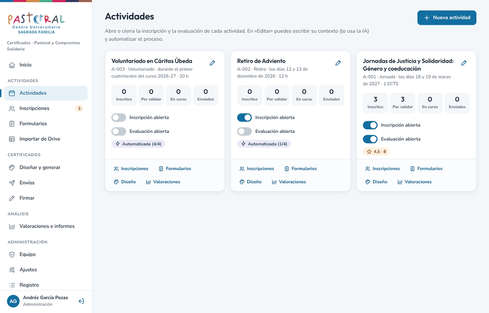
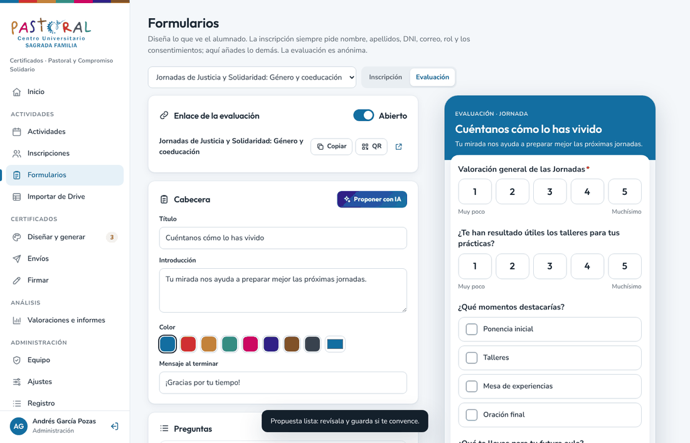
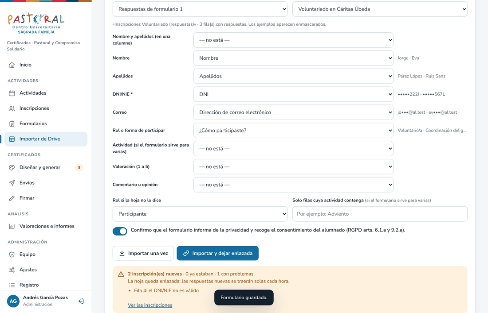
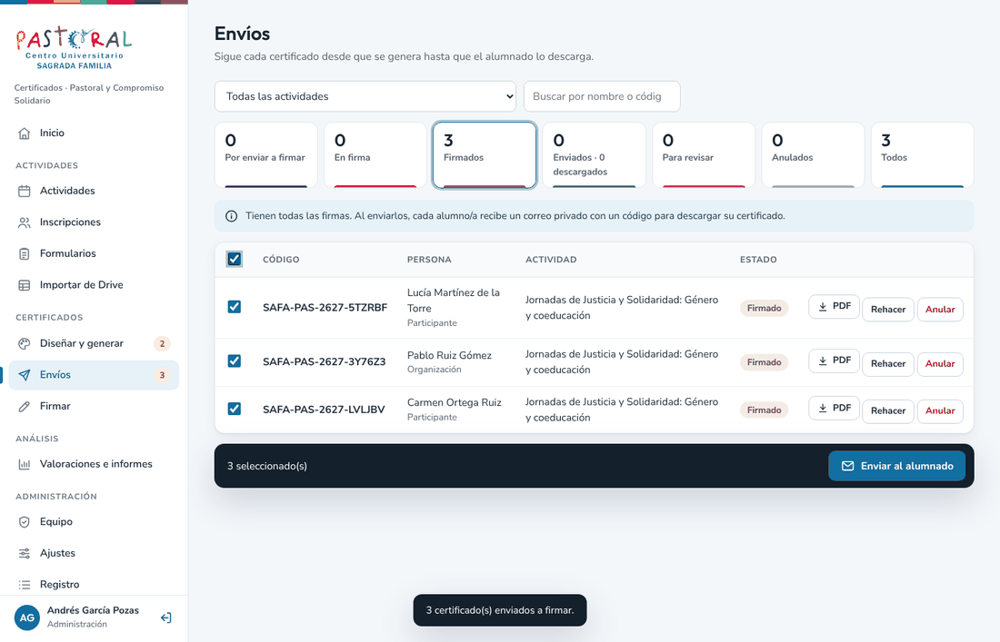
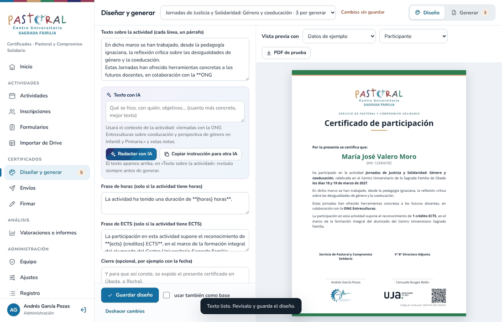
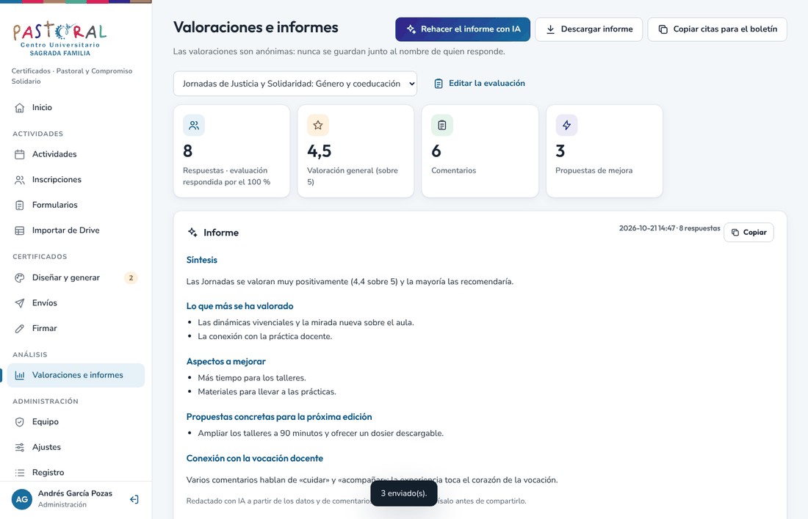
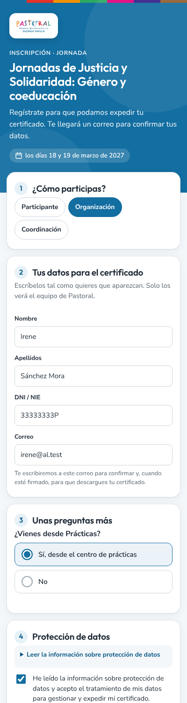
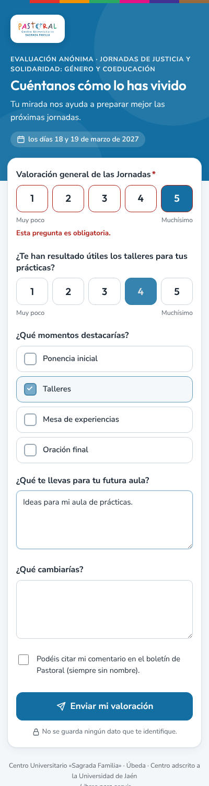
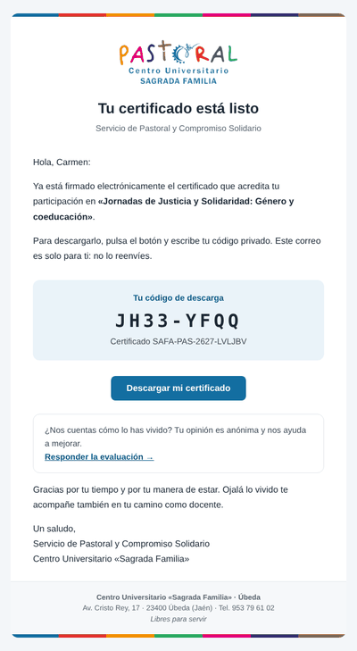
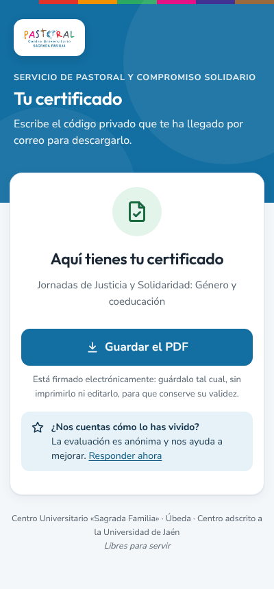

# Certificados de Pastoral · C.U. «Sagrada Familia» (Úbeda)

Aplicación web del **Servicio de Pastoral y Compromiso Solidario** para emitir los certificados de sus actividades.
Funciona sobre el Google Workspace del centro (Apps Script, Drive y Gmail): no tiene coste y los datos no salen de vuestro Google
(salvo lo que se envíe, anonimizado, a la IA si se activa).

```
Alumnado ─ formulario de inscripción de la actividad (o una hoja de Drive enlazada) ─ confirma por correo
Equipo   ─ valida → diseña y genera los PDF → «Enviar a firmar» → firma 1 → firma 2 (Autofirma) → «Enviar al alumnado»
Alumnado ─ recibe un correo privado con un código → descarga su certificado → responde la evaluación anónima
Equipo   ─ informe de valoraciones y propuestas de mejora (con IA, opcional)
```

Cada actividad puede automatizarse: validar sola, generar en el servidor, enviar a firmar y enviar al alumnado.


| | |
| --- | --- |
|  |  |
|  |  |
|  |  |

| Inscripción | Evaluación | Correo | Descarga |
| --- | --- | --- | --- |
|  |  |  |  |

## Instalar (una vez, con la cuenta propietaria)

1. En Google Drive: **Nuevo > Más > Google Apps Script**. Ponle nombre («Certificados Pastoral»).
2. Abre [`dist/CertificadosPastoral.gs`](https://raw.githubusercontent.com/agarcia-poz/certificados-pastoral/main/dist/CertificadosPastoral.gs), copia todo y pégalo en `Código.gs`, sustituyendo lo que haya. Guarda.
3. **Implementar > Nueva implementación > ⚙️ Aplicación web**. Ejecutar como: **Yo**. Quién tiene acceso: **Cualquier usuario**. Implementar y autorizar.
4. Abre la URL de la aplicación web. Un asistente pide un código que llega a la cuenta propietaria y lo prepara todo.
5. Para la IA: en **Ajustes**, administración pega la clave de la API de Groq. Nunca se escribe en el código.

## Actualizar

Pega la versión nueva en `Código.gs`, guarda y en **Implementar > Gestionar implementaciones > ✏️ > Versión: Nueva versión > Implementar**.
La dirección no cambia y los datos no se tocan: al abrirla, la app añade sola las columnas, carpetas y tareas que falten.
Si Google pide permisos nuevos (por ejemplo, para conectarse a Groq o a jsDelivr), acéptalos.

## Qué hay aquí

| Ruta | Contenido |
| --- | --- |
| `src/Servidor.gs` | Rutas, acceso por código, papeles, datos, inscripción, certificados, firmas, envíos, descarga privada, verificación y correos. |
| `src/Formularios.gs` | Formularios propios de inscripción y de evaluación (anónima). |
| `src/Hojas.gs` | Importar desde una hoja de Drive y dejarla enlazada. |
| `src/Automatico.gs` | Tarea horaria y generación de PDF en el servidor (pdf-lib con versión fija y huella SHA-256). |
| `src/IA.gs` | Groq: texto del certificado, propuesta de formularios e informes. La clave solo vive en las propiedades del script. |
| `src/Panel.html` | Panel del equipo (una sola página). |
| `src/Editor.html` | «Diseñar y generar»: diseño por actividad, vista previa exacta y generación por lotes. |
| `src/Publico.html` | Páginas públicas: inscripción, formulario de la actividad, evaluación, confirmación, descarga y verificación. |
| `src/Estilos.html`, `src/Iconos.html`, `src/FormVista.html` | Sistema visual (paleta del logo, Outfit + Nunito Sans), iconos SVG y el dibujo común de los formularios. |
| `src/motor.js` | Motor de maquetación: una sola maquetación para la vista previa (canvas) y el PDF, en el navegador y en el servidor. |
| `assets/` | Logos (se incrustan en la app). |
| `build.py` | Genera `dist/CertificadosPastoral.gs` (todo en un archivo) y `dist/version.json`. |
| `tests/` | `run.mjs`: flujo completo con Google simulado, el motor real y el PDF del servidor. `ui.mjs`: el panel y las páginas en Chromium. |

## Datos y privacidad

- **Libro «Datos»** (privado): actividades, inscripciones sin DNI ni correo, valoraciones anónimas, equipo, ajustes y registro.
- **Bóveda** (privada, archivo aparte): DNI, nombre y correo del alumnado, sus respuestas a la inscripción y las solicitudes sin confirmar (se borran a las 72 h).
- **PDF** en una carpeta privada de la cuenta propietaria; se llaman por su código, nunca por el DNI.
- **Descarga**: el certificado no va adjunto. Cada persona recibe un código de 8 caracteres; solo se guarda su huella, con un máximo de intentos.
- **Hojas enlazadas**: lo importado va directo a la bóveda; en «Datos» solo queda una huella con sal secreta para no duplicar.
- **IA (Groq, EE. UU.)**: se envían el contexto de la actividad y, si se permite, comentarios **anonimizados** (sin correos, DNI, teléfonos ni nombres de las personas inscritas). Se puede desactivar. Conviene validarlo con el DPD.
- El equipo entra con un código de 6 cifras enviado a su correo (10 minutos, 5 intentos); la sesión dura 6 horas. Cada llamada comprueba sesión y papel en el servidor.

## Publicar una versión nueva

1. Cambia `src/`, sube `VERSION_APP` en `src/Servidor.gs` y añade su sección en `NOVEDADES.md`.
2. `python3 build.py` y `cd tests && npm install && npm test` (y `npm run ui` si tienes Chromium).
3. Sube los cambios a `main`. Las pruebas de GitHub comprueban también que `dist/` está al día.

Reglas: ningún DNI ni correo del alumnado fuera de la bóveda (ni en nombres de archivo, asuntos o registro);
datos de prueba siempre ficticios; ni correos reales ni claves en este repositorio, que es público.
