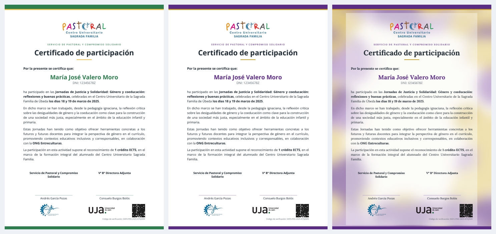
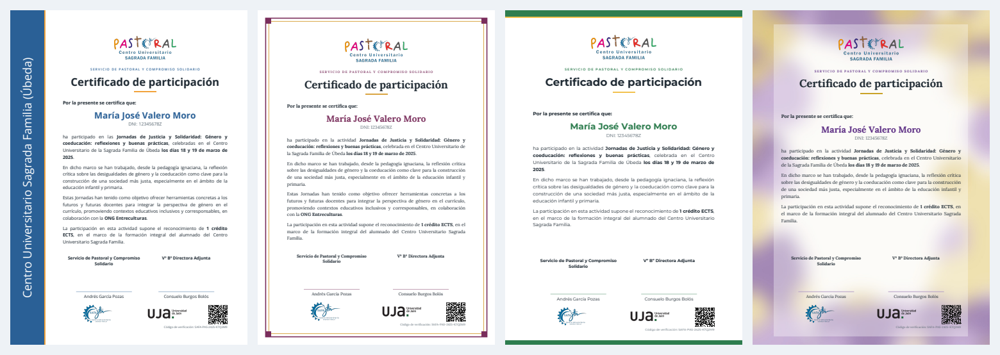
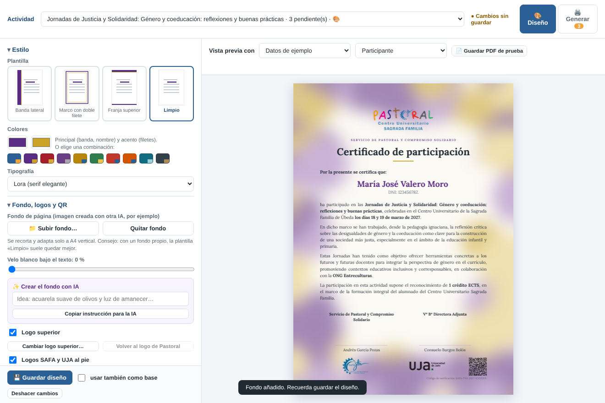

# Certificados de Pastoral · C.U. «Sagrada Familia» (Úbeda)

App de Google Apps Script para emitir los certificados de las actividades del **Servicio de Pastoral y Compromiso Solidario**.

```
Formulario (registro + valoración anónima)
   → validación en la hoja «Participaciones»
   → editor de diseño con vista previa exacta → PDF (nombrado por código, nunca por DNI)
   → firma 1 → firma 2 (Autofirma, carpetas «Para firmar» / «Firmados por…»)
   → envío automático al alumno/a → verificación pública por código o QR
```

Diseño por defecto: franjas arriba y abajo (color cambiable, admite imagen de fondo).







## Qué hay aquí

| Carpeta | Contenido |
| --- | --- |
| `src/Codigo.gs` | Servidor: hojas, bóveda, formulario, circuito de firmas, correos, verificación y funciones del editor (`api_*`, todas exigen la cuenta propietaria). |
| `src/Editor.html` | Editor que se abre dentro de la hoja: diseño por actividad, textos, fondos, ayuda para IA y generación por lotes. |
| `src/motor.js` | Motor de maquetación: una sola maquetación con dos salidas idénticas, la vista previa (canvas) y el PDF (pdf-lib). |
| `assets/` | Logos de Pastoral, SAFA y UJA (se incrustan en la app). |
| `build.py` | Genera `dist/`, lo que descarga la app: `Codigo.gs`, `LogoCorreo.gs`, `Editor.html`, `Motor.html`, `Logos.html`, `appsscript.json` y `version.json` (versión, novedades y huellas). |
| `instalador/` | Los dos textos que se pegan una sola vez para instalar la app. |
| `tests/` | Simulación de Google + motor real: recorre el flujo completo y las reglas de privacidad. |

## Instalar y actualizar (sin instalar programas)

1. Crea una hoja de cálculo nueva > Extensiones > Apps Script.
2. ⚙️ Configuración del proyecto > marca «Mostrar el archivo de manifiesto "appsscript.json"».
3. Pega `instalador/appsscript.json` en `appsscript.json` e `instalador/Instalador.gs` en `Código.gs`. Guarda.
4. Activa la «API de Google Apps Script» en https://script.google.com/home/usersettings.
5. Ejecuta `instalarDesdeGitHub`, recarga el editor y ejecuta `instalar`.

Actualizar: en la hoja, **⛪ Certificados > 🔄 Actualizar la app** y después **Instalar / reparar**.
La app descarga `dist/` de la rama `main` en un commit fijo y comprueba la huella SHA-256 de cada archivo
(`dist/version.json`) antes de sustituir el código. Los datos no se tocan.

## Publicar una versión nueva

1. Cambia el código en `src/`, sube `VERSION_APP` en `src/Codigo.gs` y añade su sección en `NOVEDADES.md`.
2. `python3 build.py` (regenera `dist/`) y `cd tests && npm install && npm test`.
3. Sube los cambios a `main`. Las pruebas de GitHub comprueban también que `dist/` está al día.

## Reglas que el código no debe romper

1. Ningún DNI ni correo del alumnado en la hoja de gestión, nombres de archivo, asuntos, URL o registro. Solo en la bóveda.
2. Las funciones que llama el navegador (`api_*`) comprueban en el servidor que quien llama es la cuenta propietaria.
3. Cada correo se envía una sola vez. El formulario no guarda respuestas.
4. Datos de prueba siempre ficticios. Ni correos reales ni credenciales en el repositorio: es público.

La guía de instalación y uso para el equipo está en el documento «Certificados de Pastoral · Guía de instalación y uso».
